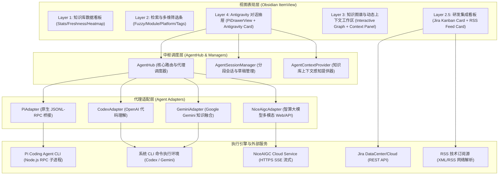
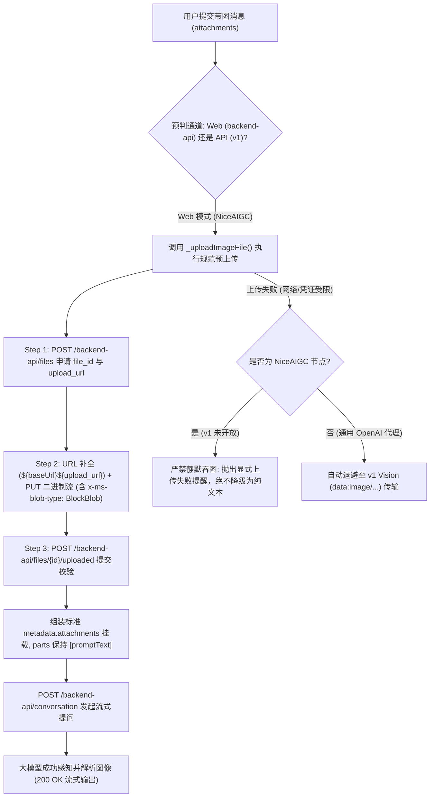

# TabonKB 研发工作台 (TabonKB Workbench) - V1.0.0 架构与功能设计文档

**文档版本**: V1.0.0  
**制定日期**: 2026-09-17  
**定位体系**: 专为手机驱动开发定制的原生数据看板、知识图谱、集成工作台与 Multi-Agent 对话中枢  
**插件归属**: `d:\work\Mgmt\TabonKB\.obsidian\plugins\tabonkb-workbench`

---

## 一、系统总体架构设计

TabonKB 研发工作台采用分层解耦的插件化架构，全面嵌入 Obsidian 桌面环境。整体分为五大核心功能层：



---

## 二、Multi-Agent Hub 核心调度设计

### 1. 代理适配器抽象（AgentAdapter Pattern）
所有 AI 代理均继承自统一的抽象基类 `AgentAdapter`（`providers/agent-adapter-base.js`），实现严格的标准接口契约：
- `detect()`: 异步检测本地 CLI/运行环境是否就绪；
- `start()`: 初始化或拉起代理引擎；
- `stop()`: 优雅停止或释放进程资源；
- `send(text, contextPayload, attachments)`: 发送提示词与多模态附件；
- `abort()`: 中止当前流式响应；
- `newSession()`: 开启全新对话会话；
- `getModelGroups()` / `getModel()` / `setModel(id)`: 模型列表与当前模型管理；
- `supportsReasoningEffort(modelId)` / `setReasoningEffort(level)`: 深度推理等级控制。

### 2. 四大引擎特性定位
1. **Pi Agent (`PiAdapter` + `PiAgentBridge`)**:
   - **定位**: 本地轻量代码与笔记快速检索维护助手；
   - **通信机制**: Stdin/Stdout 双向管道 JSON-RPC 流式通信；
   - **权限模型**: 支持 `readonly` (read, grep, find, ls) 与 `readwrite` (增加 write, edit) 双模无缝切换；
   - **环境解析**: 针对 Windows Obsidian Electron 桌面环境，自动识别 `AppData\Roaming\node-v24.15.0\node.exe` 绝对路径并注入子进程 `PATH`，杜绝 `ENOENT` 异常；
   - **进程安全**: 监听 Obsidian 卸载与窗口关闭事件，支持 Windows 进程树清理 (`taskkill /T /F`)，杜绝孤儿进程。
2. **Codex CLI (`CodexAdapter`)**:
   - **定位**: 专注于深度代码逻辑分析与系统重构；
   - **通信机制**: CLI 进程唤起与参数封装。
3. **Gemini CLI (`GeminiAdapter`)**:
   - **定位**: 专注于知识体系关联与综合分析；
   - **通信机制**: Node CLI Bundle 自动化拉起。
4. **NiceAIGC (`NiceAigcAdapter`)**:
   - **定位**: 通用大模型交互与多模态图文对话；
   - **通信机制**: HTTPS REST / Server-Sent Events (SSE) 高并发流式通信；
   - **解耦设计**: **严格解耦知识库上下文前缀**，不向提问注入 `[TabonKB 研发工作台查询]` 标签，保证纯粹通用对话体验。

### 3. Agent 切换与生命周期状态机
- **状态流转**: `disconnected` -> `connecting` -> `connected (已就绪)` -> `thinking (思考中)` / `running_tool (调用工具)` -> `agent_settled`。
- **自动拉起机制 (Auto-Start)**: 在 `AgentHub.switchAgent(agentId)` 时，若目标 Agent 未启动，自动检测并拉起底层进程；UI 实时显示 `连接中...` 并过渡为绿色 `已就绪`。
- **点击重连 (Click-to-Reconnect)**: 顶部状态指示灯与文字可交互点击，异常或断开时一键触发恢复。

---

## 三、Antigravity 现代对话抽屉 UI/UX 设计

### 1. 固定 Agent Hub 切换入口
- 搜索框右侧入口固定为 **Agent Hub** 专用多代理中枢矢量图标，不随选中的具体 Agent 改变外形。
- 采用下拉菜单形式展现代理列表、运行状态与特性描述，保证视觉锚点恒定。

### 2. Antigravity 交互卡片与双向可伸缩布局
- **抽屉宽度横向拖拽**: 左边缘配备弹性 Resizer 拖拽条，宽度可在 `320px ~ 760px` 之间自由调节，记忆保存至 `localStorage`。
- **输入区域纵向拖拽**: 输入卡片上边缘配备微型滑块，高度可在 `38px ~ 500px` 之间自由调节；同时支持内容自动换行撑高与记忆恢复。
- **发送/中止按钮动态状态联动**:
  - 输入框无文字且无图片时，发送按钮呈现禁用置灰状态（`.disabled`）；
  - 输入内容或选中图片时，发送按钮高亮激活；
  - 代理流式输出过程中，发送按钮无缝切换为中止按钮（停止矢量图标），点击或按 `Esc` 即可优雅打断。

### 3. 多模态图片上传与预览灯箱
- **输入支持**:
  - 本地文件选择（图片上传按钮）；
  - 系统文件管理器或 Obsidian 文件树拖拽（Drag & Drop）直投；
  - 剪贴板截图直接粘贴（Paste 事件捕获并转为 Base64）。
- **附件呈现**: 输入框上方展示图片缩略图胶囊，标示文件名与大小，支持一键移除。
- **图片灯箱 (Lightbox)**: 点击缩略图可唤出半透明居中大图预览面板，按 `Esc` 或点击遮罩即可退出。

### 4. 全球主流 AI 模型选择器与推理等级调节
- **官方矢量品牌图标库 (`ui/iconpark.js`)**:
  - OpenAI / ChatGPT (经典星芒罗盘)
  - Anthropic / Claude (官方星形花瓣)
  - Google Gemini (四角光芒星)
  - DeepSeek (蓝色跃动鲸鱼)
  - Moonshot Kimi (月之暗面经典标识)
  - 智谱 GLM / 阿里通义千问 Qwen / 字节跳动豆包 Doubao
- **模型分类折叠与即时检索**:
  - 置顶展示「常用推荐模型」（Auto、GPT-5.6 Sol 等）；
  - 按品牌折叠手风琴面板，支持快速按模型名与描述即时模糊检索。
- **推理等级面板 (Reasoning Effort)**:
  - 针对支持思考推理的模型（如 GPT-5.6 Sol 等），弹出独立浮层：
    - `极低 (Low)` / `中等 (Medium)` / `高 (High)` / `超高 (Extra High)` / `最高 (Max)`；
  - 模型标签自动展示附加后缀（如 `GPT-5.6 Sol · 最高`）。

### 5. 分段历史会话与草稿持久化
- **草稿无缝保留**: 切换 Agent 时自动将当前未发送文本暂存至 SessionManager，切回时精准还原。
- **会话分段记录**:
  - 侧边折叠面板提供「历史会话分段记录」；
  - 默认隐藏收起，点击历史图标展开；
  - 支持会话切换、新建独立会话、删除历史会话；
- **一键导出至 Quick Note**:
  - 点击导出按钮，将当前会话完整问答格式化为 Markdown 文档；
  - 自动归档至知识库规范的 `00-Inbox/03-Quick-Note/` 目录下，并保留附件与时间戳。

---

## 四、研发看板与第三方数据集成设计

### 1. Jira 敏捷看板卡片 (`components/jira-card.js`)
- **兼容性**: 支持 Jira DataCenter 与 Jira Cloud REST API。
- **认证方式**: 支持 Cookie 凭证（企业内部环境）与 API Token / PAT 认证。
- **核心能力**:
  - JQL 自定义筛选表达式（如待办、处理中、未解决）；
  - 智能列状态归集（To Do / In Progress / Code Review / Done）；
  - 自动轮询刷新（支持 5/15/30 分钟间隔与手动即时刷新）；
  - 点击工单直接调用系统默认浏览器打开 Jira 对应详情页。

### 2. RSS 技术资讯卡片 (`components/rss-card.js`)
- **内核与驱动技术源聚合**: 预置并支持自定义技术订阅：
  - LWN Kernel 核心动态
  - Android Developers 官方更新
  - IT之家 / 科技动态
- **未读追踪与安全渲染**: 记录阅读状态，HTML 摘要清洗，防止 XSS 攻击。

---

## 五、安全与配置隔离架构

1. **凭证隔离（Zero-Leak Principle）**:
   - Jira Cookie/Token 与 NiceAIGC Token **严禁**写入 `data.json`；
   - 优先保存在客户端沙箱 `localStorage`，或持久化到插件本地 `.secrets.json`；
   - `.secrets.json` 严格列入插件的 `.gitignore` 中，杜绝任何敏感信息泄露。
2. **TabonKB 知识库规范遵循**:
   - 插件完全收敛在 `.obsidian/plugins/tabonkb-workbench` 内；
   - 不向知识库根目录新增任何非规范目录或发布文件夹。

---

## 六、多模态图文对话架构与异常防御设计

### 1. 背景与双重致命根因剖析
在 Multi-Agent 对话中枢中，用户可通过剪贴板粘贴截图、拖拽或本地选取图像向模型提问。针对第三方聚合代理（如 NiceAIGC / ChatGPT Web 会话），模型曾出现“用户已附带图片发问，但模型回复‘请把图片发上来’”的“图片脱落”现象，经深度调用链复盘，锁定了以下双重根因：

1. **根因 A (相对 URL 导致 `_uploadImageFile` 抛错崩溃)**：
   - NiceAIGC 网关 `/backend-api/files` 返回的预签名上传地址为站内相对路径：
     `upload_url: "/backend-api/ns-file-upload/file-...?nslocal=true&nstoken=..."`。
   - 客户端在 `_httpPutBinary` 中执行 `new URL(url)` 直接抛出 `TypeError: Invalid URL`，导致图片二进制数据未成功送达存储桶。
2. **根因 B (静默剥除图片与反向死循环降级)**：
   - `uploadErr` 捕获异常后，尝试降级到 `/v1/chat/completions` 通道。
   - 但 NiceAIGC Web 节点未开放 v1 接口，上游直接返回 `HTTP 503: Service Unavailable {"code":"api_not_enabled"}`。
   - 503 触发错误捕获反向回退回 `backend-api`，然而此时图片队列已被剥离，最终发送的实际请求退化为纯文本 `parts: ["解读下这个图片"]`，模型因而回复“请把图片发上来”。
3. **根因 C (FastAPI Pydantic 数据模式校验冲突 - HTTP 422)**：
   - 服务端基于 Python FastAPI + Pydantic v2 构建，其 `messages[*].content.parts` 强类型定义为 `list[str | UntrustedText]`。
   - 若将 `{ content_type: 'image_asset_pointer' }` 塞入 `parts`，将触发：
     `type: "string_type", loc: ["messages", 1, "content", "multimodal_text", "parts", 1, "str"], msg: "Input should be a valid string"`，返回 **HTTP 422 Unprocessable Entity**。
   - ChatGPT Web 原生协议真实规范要求：图片凭证挂载在 `messages[*].metadata.attachments`，而 `content.parts` 必须保持纯文本数组 `[promptText]`。

### 2. 规范多模态流转拓扑架构



### 3. 核心技术实现细节
1. **轻量二进制图像头探测 (`getImageDimensions`)**：
   - 纯原生 Node.js Buffer 实现，根据文件签名魔数快速解析 PNG（IHDR 块）、JPEG（SOF0/SOF2 标记）、GIF（87a/89a）等主流格式真实分辨率与像素宽高，不引入第三方庞大图形库依赖。
2. **两阶段规范化预上传与相对路径解析 (`_uploadImageFile`)**：
   - 自动检测 `upload_url` 是否以 `/` 开头，若为相对路径自动拼接 `${baseUrl}`；
   - 对站内上传透传 Session/Cookie/Token 身份凭证并补充 `'x-ms-blob-type': 'BlockBlob'`，上传成功后发送 `/uploaded` 确认信号。
3. **协议解耦与 Attachments 标准挂载**：
   - 废除将 Object 塞入 `parts` 的旧逻辑，遵从 ChatGPT Web 官方协议规范：
     ```json
     {
       "content": {
         "content_type": "text",
         "parts": ["解读下这个图片"]
       },
       "metadata": {
         "attachments": [
           {
             "id": "file-service://file-xxxxx",
             "name": "screenshot.png",
             "size": 102400,
             "mime_type": "image/png",
             "width": 1280,
             "height": 720
           }
         ]
       }
     }
     ```
   - 彻底避免 FastAPI Pydantic schema 的 422 拦截校验。
4. **禁止静默降级原则 (No Silent Degradation)**：
   - 若多模态文件上传失败，严禁静默脱落图片转发纯文本，直接向用户界面暴露真实错误，避免造成“发了图但模型看不见”的困惑体验。
